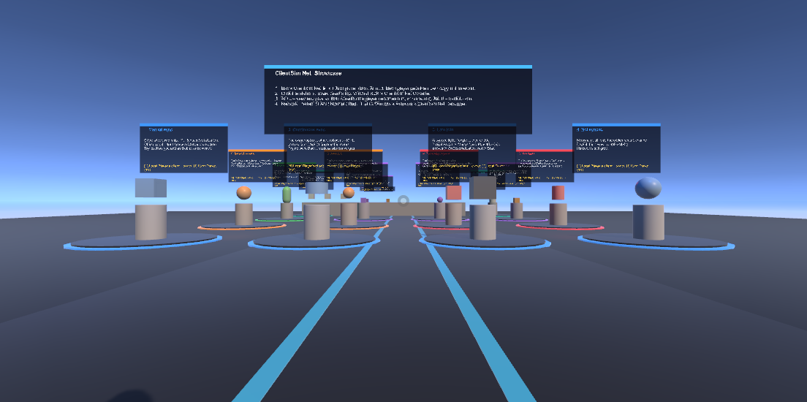
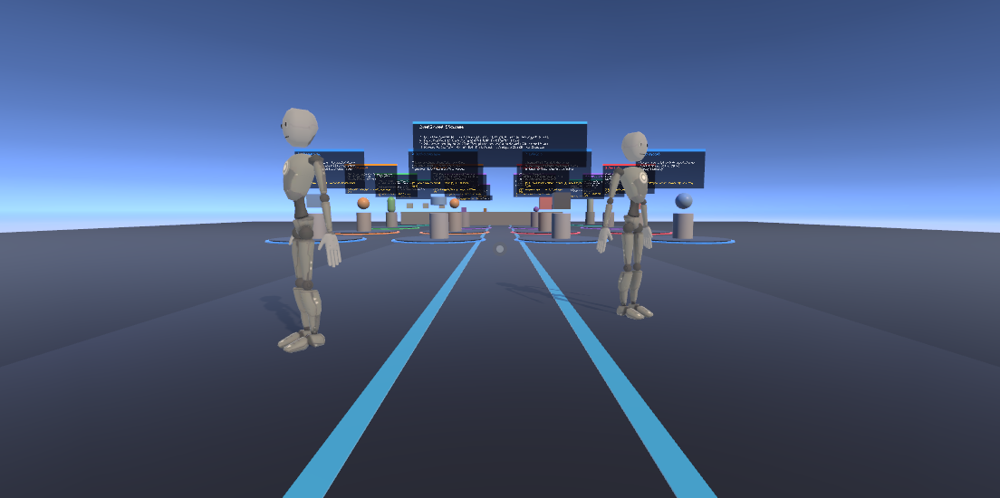
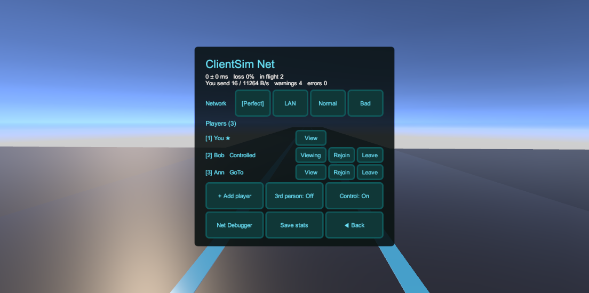

# ClientSim Net

> Documentation version: **0.1.1** · [Release](https://github.com/LogicCuteGuy/ClientSimNet/releases/tag/0.1.1)

**ClientSim Net** (`com.logiccuteguy.clientnetsim`) is a multiplayer network simulator for VRChat's ClientSim. Stock ClientSim has no latency, no `OnDeserialization`, and runs `Owner`/`Others` events locally, so most networking bugs stay hidden until you upload. ClientSim Net adds remote puppet players to one Unity editor so you can test them in Play mode.

[](/img/clientsimnet/showcase.png)

## What's new in 0.1.1

Every player's world now also shows the other players (you included) as a named capsule at their own-client position, so you can see who is where when viewing as a puppet. The capsules are a picture only: no collider, no latency.

## Features

- **Remote puppet players**: each gets its own copy of the world, where their Udon runs (`Networking.LocalPlayer`, `IsOwner`, `IsMaster` answer for them).
- **Real network path**: synced variables go through `RequestSerialization` and `OnDeserialization` with latency, jitter and packet loss. Presets: Perfect, LAN, Normal, Bad.
- **VRChat limits**: manual sync (280,496 B) and continuous sync (~200 B, 10 Hz) size limits, `[NetworkCallable]` rate limit (5/s), ~11 KB/s bandwidth warning.
- **Ownership and events**: `All`/`Others`/`Owner`/`Self` targets, `OnOwnershipRequest` on both sides, ownership races, master and player leave, late join.
- **Pickups and PlayerObjects**: pickups with and without `VRCObjectSync`, per-player `VRCPlayerObject` copies.
- **Tools**: in-game menu page, **Net Debugger** timeline window, per-player console, saved stats, and a scripting API (`NetSimApi`) with a `clientsim_net` unity-mcp tool.
- **Sample world**: a lit plaza with 14 signed stations, one per networking use case.

[](/img/clientsimnet/puppets.png)

## Requirements

- **Unity** 2022.3
- **VRChat Worlds SDK** 3.10.0 or newer (`com.vrchat.worlds`)

## License

MIT.

## Installation

### VCC / ALCOM

1. [Add the LogicCuteGuy VPM repository](https://vpm.logiccuteguy.com/) to VCC/ALCOM, or add `https://vpm.logiccuteguy.com/index.json` manually. Refresh the listing if it is already added.
2. Open **Manage Project** for your Unity project.
3. Find **ClientSim Net** (`com.logiccuteguy.clientnetsim`) and add **0.1.1**.
4. Open the project in Unity and let the package import.

### Unity Package Manager / manual

In **Window > Package Manager > + > Add package from git URL**, enter:

```text
https://github.com/LogicCuteGuy/ClientSimNet.git#0.1.1
```

Choose **one installation method per project** to avoid duplicate copies. Do not use GitHub's automatic **Source code (zip)** archive; use the named `com.logiccuteguy.clientnetsim-0.1.1.zip` from the release.

## Quick start

1. In **Package Manager > ClientSim Net > Samples**, import **Test World**, then open `NetSimShowcase.unity` (a guided tour) or `NetSimTest.unity` (a plain test scene).
2. Press **Play**. ClientSim Net starts with ClientSim.
3. Open **VRChat SDK > ClientSim Net**, pick a network preset (**Normal** for realism, **Perfect** for deterministic checks) and **Add player**.
4. Click objects as yourself, then use the 👁 button per player (or Alt+1..9, Alt+0 for you) to view their copy of the world and see what they see.

[](/img/clientsimnet/menu.png)

Shortcuts: Alt+[ / Alt+] cycle players, Alt+T toggles third person, Alt+C toggles **Control** (ClientSim's own player acts as the viewed puppet).

## Menus

| Menu | Opens |
|---|---|
| **VRChat SDK > ClientSim Net** | Main window: enable toggle, presets, players |
| **Window > Analysis > ClientSim Net Debugger** (also under VRChat SDK) | Profiler-style 30 s timeline of bytes on the wire, with Messages / Players / Objects tabs |
| **VRChat SDK > ClientSim Net Console** | One console tab per player |
| **VRChat SDK > ClientSim Net - Build Test Scene / Build Showcase Scene** | Rebuilds the sample scenes |

Console lines from the package start with `[ClientSimNet]`. Warnings and errors there are real networking bugs in your world, or a limit you hit.

## How it differs from VRChat

Remote worlds step their own physics, but raycasts from their Udon query your scene, puppets have no wall collision, and voice and avatars are not simulated. Sync sizes are a per-type estimate, not real wire bytes. Each player's world costs a full scene copy. See [Using ClientSim Net](./usage.md) for the full list.

To disable the simulator, untick **Enable** in the window (applies next Play).

Next: [Using ClientSim Net](./usage.md).
