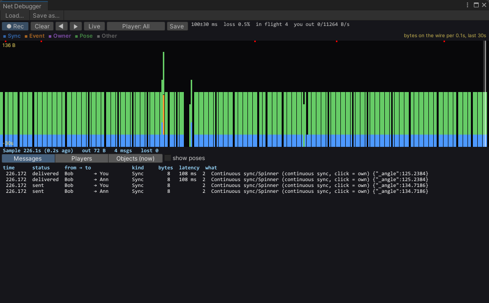

# Using ClientSim Net

Networked code is not done until it passes the [test scenarios](./scenarios.md) in Play mode with **at least two remote players**.

## Mental model

- One Unity editor, **one world copy per player**. Each remote puppet gets a hidden scene `NetSim World <name> [id]`, loaded when they join. Their copy changes **only** through the network (synced variables, network events, ObjectSync, ownership). Anything not synced stays different, as in VRChat.
- Everything crossing the wire goes encode, bytes, delayed queue, decode.
- `RequestSerialization` from a non-owner is dropped with a warning.
- Events: `All` runs locally and sends; `Others` never runs locally; `Owner` runs locally only if you own the object; `Self` is local only.
- Late join: untick ClientSim's **Local Player Is Master** before Play. The remote master then sends every synced behaviour's state shortly after the network settles.

## Scripting

Drive the simulator from code with `NetSimApi`, or with the `clientsim_net` unity-mcp tool. See [Scripting and unity-mcp](./scripting-api.md).

## Net Debugger

The **Net Debugger** shows a 30 s timeline of bytes on the wire per 0.1 s, stacked by kind (Sync, Event, Owner, Pose). Click or drag to select a sample; the tabs below list its messages (sender, receiver, size, latency, payload), per-player totals and per-object state. Red marks a limit hit, a lost message or an object out of sync; **CLOGGED** means your outbound traffic is over ~11 KB/s. **Save** writes `Library/ClientSimNet/netstats-<time>.json`, which **Load…** reopens later, even outside Play mode.

## Test scenarios

Run the [test scenarios](./scenarios.md) that apply to your feature.

## Known limits

- Sync sizes are an estimate per type, not real wire bytes.
- Player APIs other than `TeleportTo` (Immobilize, SetWalkSpeed, …) on a puppet do nothing.
- Remote Udon `Physics.Raycast` queries your scene; the puppet's body is not in its own world.
- `VRCInstantiate` spawns land in your scene. (PlayerObjects get their own copy in every world since 0.1.2.)
- No `VRCObjectPool` spawning by puppets: take ownership of the pool object instead.
- SDK internals are reached by reflection. After an SDK update, run **Test Runner > EditMode > ClientSimNet.Tests** first.
