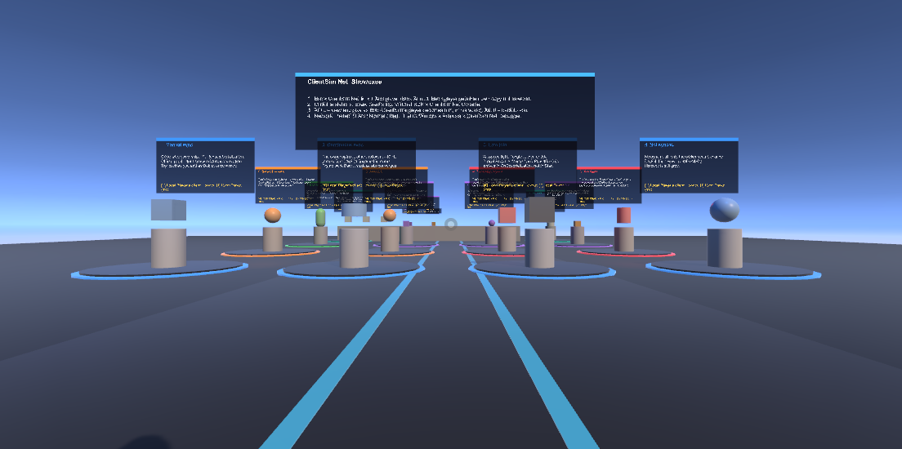
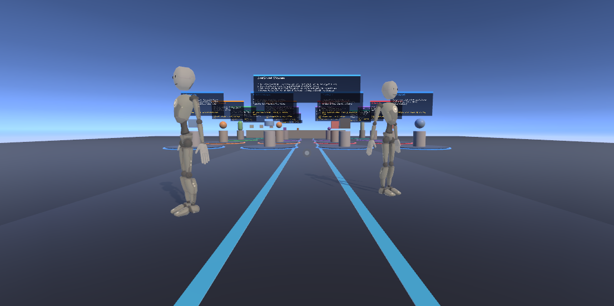
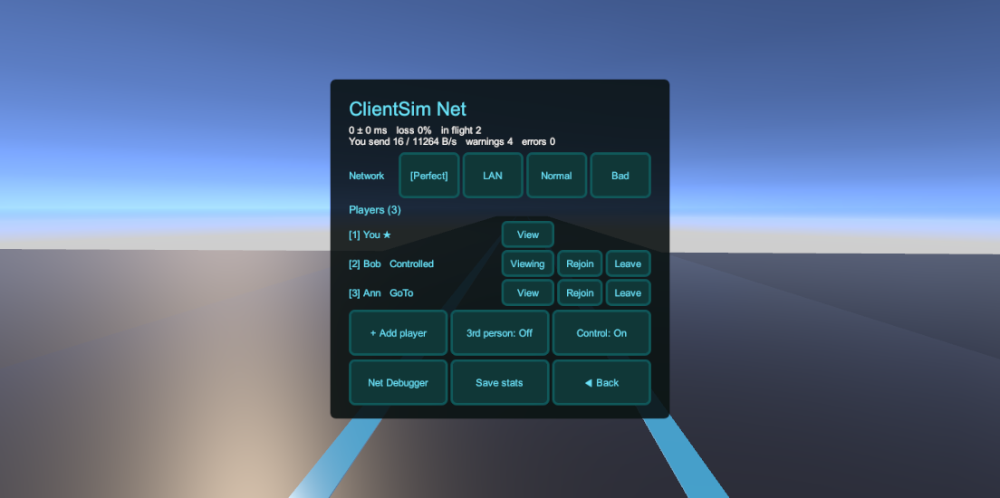

# ClientSim Net

> ドキュメントバージョン: **0.1.2** · [リリースノート](https://github.com/LogicCuteGuy/ClientSimNet/releases/tag/0.1.2)

**ClientSim Net**（`com.logiccuteguy.clientnetsim`）は、VRChat の ClientSim 向けマルチプレイヤーネットワークシミュレーターです。標準の ClientSim には遅延も `OnDeserialization` もなく、`Owner`/`Others` イベントはローカルで実行されます。そのため、ネットワークの不具合の多くはアップロードするまで見つかりません。ClientSim Net は 1 つの Unity エディターにリモートのパペットプレイヤーを追加し、Play モードでテストできるようにします。

[](/img/clientsimnet/showcase.png)

## 0.1.2 の新機能

各リモートプレイヤーのワールドが、全プレイヤーの PlayerObject のコピーを個別に持つようになりました。同期状態、ネットワークイベント、インタラクト、`Networking.FindComponentInPlayerObjects` はそのプレイヤー自身のクライアントで実行されます。そのため「あなた → Bob」の流れ（Bob のカードをクリックすると Bob に `Owner` イベントが送られ、Bob が検証して書き込む）を、配線を変えずにテストできます。シーンのルートにあるネットワークオブジェクト（ルートに置いた PlayerObject テンプレートなど）も、すべてのワールドにコピーされます。

0.1.1: すべてのプレイヤーのワールドに、他のプレイヤー（あなたを含む）が名前付きのカプセルとして、本人のクライアント上の位置に表示されます。パペットの視点で、誰がどこにいるかを確認できます。カプセルは見た目だけで、コライダーも遅延もありません。

## 機能

- **リモートのパペットプレイヤー**: それぞれが自分のワールドのコピーを持ち、その中で Udon が動きます（`Networking.LocalPlayer`、`IsOwner`、`IsMaster` はそのプレイヤーの立場で応答します）。
- **実際のネットワーク経路**: 同期変数は遅延、ジッター、パケットロス付きで `RequestSerialization` と `OnDeserialization` を通ります。プリセット: Perfect、LAN、Normal、Bad。
- **VRChat の制限**: Manual 同期（280,496 B）と Continuous 同期（約 200 B、10 Hz）のサイズ制限、`[NetworkCallable]` のレート制限（5 回/秒）、約 11 KB/s の帯域警告。
- **所有権とイベント**: `All`/`Others`/`Owner`/`Self` の送信先、両側の `OnOwnershipRequest`、所有権の競合、マスターとプレイヤーの退出、途中参加。
- **ピックアップと PlayerObject**: `VRCObjectSync` の有無両方のピックアップと、プレイヤーごとの `VRCPlayerObject` のコピー。
- **ツール**: ゲーム内メニューのページ、**Net Debugger** タイムラインウィンドウ、プレイヤーごとのコンソール、統計の保存、`clientsim_net` unity-mcp ツール付きのスクリプト API（`NetSimApi`）。
- **サンプルワールド**: ネットワークの用途ごとに 1 つ、計 14 の看板付きステーションがあるライティング済みの広場。

[](/img/clientsimnet/puppets.png)

## 要件

- **Unity** 2022.3
- **VRChat Worlds SDK** 3.10.0 以降（`com.vrchat.worlds`）

## ライセンス

MIT。

## インストール

### VCC / ALCOM

1. VCC/ALCOM に [LogicCuteGuy の VPM リポジトリを追加](https://vpm.logiccuteguy.com/)するか、`https://vpm.logiccuteguy.com/index.json` を手動で追加します。追加済みの場合はリストを更新します。
2. Unity プロジェクトの **Manage Project** を開きます。
3. **ClientSim Net**（`com.logiccuteguy.clientnetsim`）を探して **0.1.2** を追加します。
4. Unity でプロジェクトを開き、パッケージのインポートを待ちます。

### Unity Package Manager / 手動

**Window > Package Manager > + > Add package from git URL** に次を入力します。

```text
https://github.com/LogicCuteGuy/ClientSimNet.git#0.1.2
```

コピーの重複を避けるため、**インストール方法はプロジェクトごとに 1 つ**にしてください。GitHub が自動生成する **Source code (zip)** は使わず、リリースの `com.logiccuteguy.clientnetsim-0.1.2.zip` を使います。

## クイックスタート

1. **Package Manager > ClientSim Net > Samples** で **Test World** をインポートし、`NetSimShowcase.unity`（ガイドツアー）または `NetSimTest.unity`（シンプルなテストシーン）を開きます。
2. **Play** を押します。ClientSim Net は ClientSim と一緒に起動します。
3. **VRChat SDK > ClientSim Net** を開き、ネットワークプリセット（現実に近づけるなら **Normal**、毎回同じ結果で確認するなら **Perfect**）を選んで **Add player** を押します。
4. 自分でオブジェクトをクリックし、各プレイヤーの 👁 ボタン（または Alt+1..9、自分は Alt+0）でそのプレイヤーのワールドのコピーを表示して、何が見えているかを確認します。

[](/img/clientsimnet/menu.png)

ショートカット: Alt+[ / Alt+] でプレイヤー切り替え、Alt+T で三人称の切り替え、Alt+C で **Control** の切り替え（ClientSim のプレイヤーが、表示中のパペットとして操作します）。

## メニュー

| メニュー | 開くもの |
|---|---|
| **VRChat SDK > ClientSim Net** | メインウィンドウ: 有効化の切り替え、プリセット、プレイヤー |
| **Window > Analysis > ClientSim Net Debugger**（VRChat SDK の下にもあります） | 送信バイトを表示するプロファイラー形式の 30 秒タイムライン。Messages / Players / Objects タブがあります |
| **VRChat SDK > ClientSim Net Console** | プレイヤーごとに 1 つのコンソールタブ |
| **VRChat SDK > ClientSim Net - Build Test Scene / Build Showcase Scene** | サンプルシーンを再生成します |

パッケージのコンソール出力は `[ClientSimNet]` で始まります。そこに出る警告とエラーは、ワールドの実際のネットワーク不具合か、到達した制限です。

## VRChat との違い

リモートのワールドは物理演算を個別に進めますが、その Udon からのレイキャストはあなたのシーンを対象にします。パペットは壁と衝突せず、音声とアバターはシミュレートしません。同期サイズは型ごとの推定値で、実際の通信バイト数ではありません。プレイヤーごとのワールドはシーン全体のコピー 1 つ分の負荷がかかります。詳しい一覧は [ClientSim Net の使い方](./usage.md)を参照してください。

シミュレーターを無効にするには、ウィンドウの **Enable** のチェックを外します（次の Play から反映されます）。

次: [ClientSim Net の使い方](./usage.md)。
