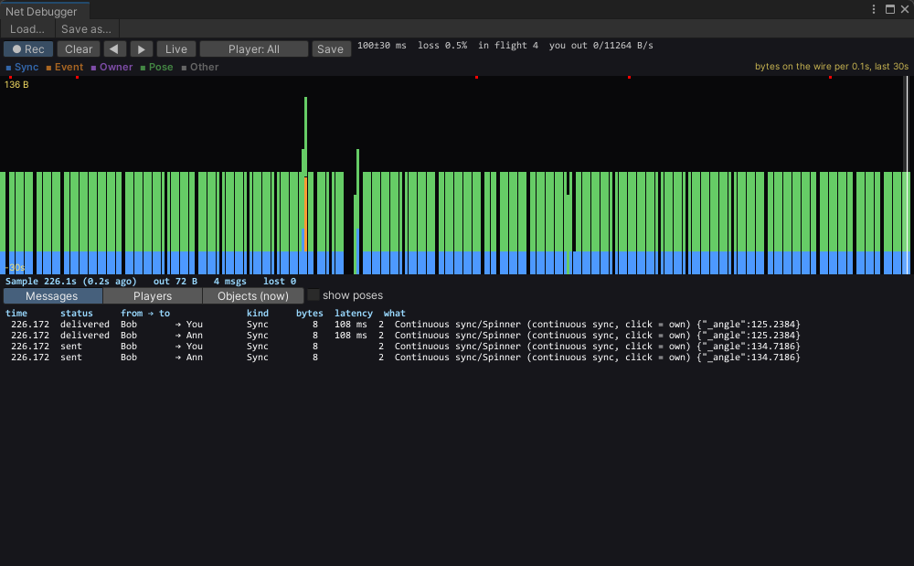

# ClientSim Net の使い方

ネットワークのコードは、**2 人以上のリモートプレイヤー**がいる Play モードで[テストシナリオ](./scenarios.md)に合格するまで完成ではありません。

## 基本の考え方

- Unity エディターは 1 つで、**プレイヤーごとにワールドのコピーが 1 つ**あります。リモートのパペットには、参加時に読み込まれる非表示のシーン `NetSim World <name> [id]` が割り当てられます。そのコピーは**ネットワーク経由でのみ**変化します（同期変数、ネットワークイベント、ObjectSync、所有権）。同期していないものは、VRChat と同じように違ったままになります。
- 通信されるデータはすべて、エンコードしてバイト列にし、遅延キューを通してからデコードします。
- 所有者以外の `RequestSerialization` は、警告を出して破棄します。
- イベント: `All` はローカルで実行して送信します。`Others` はローカルでは実行しません。`Owner` は自分がオブジェクトの所有者の場合だけローカルで実行します。`Self` はローカルのみです。
- 途中参加: Play の前に ClientSim の **Local Player Is Master** のチェックを外します。ネットワークが落ち着くと、リモートのマスターがすべての同期 Behaviour の状態を送信します。

## スクリプトからの操作

`NetSimApi` または `clientsim_net` unity-mcp ツールで、コードからシミュレーターを操作できます。[スクリプトと unity-mcp](./scripting-api.md) を参照してください。

## Net Debugger

**Net Debugger** は、送信バイト数を 0.1 秒ごと、種類別（Sync、Event、Owner、Pose）に積み上げた 30 秒のタイムラインです。クリックまたはドラッグでサンプルを選ぶと、下のタブにメッセージ（送信者、受信者、サイズ、遅延、ペイロード）、プレイヤーごとの合計、オブジェクトごとの状態が表示されます。赤は制限への到達、失われたメッセージ、同期がずれたオブジェクトを示します。**CLOGGED** は送信量が約 11 KB/s を超えていることを示します。**Save** は `Library/ClientSimNet/netstats-<time>.json` を書き出します。**Load…** で後から開くことができ、Play モード外でも使えます。

## テストシナリオ

作った機能に関係する[テストシナリオ](./scenarios.md)を実行してください。

## 既知の制限 {/* #known-limits */}

- 同期サイズは型ごとの推定値で、実際の通信バイト数ではありません。
- `TeleportTo` 以外の Player API（Immobilize、SetWalkSpeed など）は、パペットには効果がありません。
- リモートの Udon の `Physics.Raycast` はあなたのシーンを対象にします。パペット自身の体は、そのパペットのワールドにはありません。
- `VRCInstantiate` で生成したものはあなたのシーンに置かれます（PlayerObject は 0.1.2 からすべてのワールドに個別のコピーがあります）。
- パペットは `VRCObjectPool` から生成できません。代わりにプール内のオブジェクトの所有権を取得してください。
- SDK の内部にはリフレクションでアクセスします。SDK の更新後は、最初に **Test Runner > EditMode > ClientSimNet.Tests** を実行してください。
