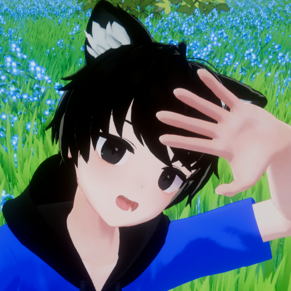

# LogicCuteGuy VRC/Unity

  

**LogicCuteGuy** の Unity および VRChat 開発ツールのセントラルリポジトリへようこそ。ワークフローの強化、パフォーマンスの最適化、およびワールド構築の簡素化を実現するために設計された一連のユーティリティを提供します。

  <h2 style={{margin: 0, fontSize: '1.8rem', fontWeight: 800}}>クイックインストール</h2>
  
VRChat Creator Companion (VCC) にリポジトリを追加して、ワンクリックですべてのツールにアクセスし、更新できます。

  
  <a href="vcc://vpm/addRepo?url=https://vpm.logiccuteguy.com/index.json" className="button--vcc" style={{fontSize: '1.2rem', padding: '16px 36px'}}>
    VCC でインストール
    <svg width="24" height="24" viewBox="0 0 24 24" fill="none" stroke="currentColor" strokeWidth="3" strokeLinecap="round" strokeLinejoin="round"><path d="M5 12h14"></path><path d="M12 5l7 7-7 7"></path></svg>
  </a>
  
  Unity 2022.3.x および VCC をサポート

[BOOTH 用の正方形 VCC 埋め込みコード](/ja/booth-embed)。

## 利用可能なプロジェクト

すべての package は [LogicCuteGuy VPM リスト](./packages.md)（`https://vpm.logiccuteguy.com/index.json`）で公開されています。DigHoleIt は Git tag と名前付き GitHub Release package も公開しています。

### [Help Tools (ヘルプツール)](./helptools/intro.md) — `com.logiccuteguy.helptools` v1.0.1
ライトマップのスケーリング、アセット分析、シェーダーマッピング、および階層の整理のための 15 以上のプロフェッショナルなエディターユーティリティのコレクション。

### [LCGUdonSharp](./lcgudonsharp/intro.md) — `com.logiccuteguy.lcgudonsharp` v0.5.0

LCGUdonSharp **0.5.0** は VRChat SDK の UdonSharp を置き換えずにフックします。インストーラーはなく、SDK のファイルも変更しません。Worlds SDK `>=3.10.6 <3.11.0` が必要です。コンパイラー側のネットワーク機能は削除され（[LCG Network System](./unity-vrc/lcgnetwork/intro) を参照）、SBP 互換パッケージは不要になり、リリースにサンプルはありません。0.4.x 以前からの更新には追加の手順が必要です。[インストール](./lcgudonsharp/install.md)を参照してください。以下の以前のバージョンの説明は履歴です。

LCGUdonSharp 0.3.12 は、インストール済みの VRChat Worlds SDK が対応バージョン `3.10.5` と異なる場合に、ブロックではなく**警告**するようになりました。ペイロード（SDK 3.10.5 でビルド）はそのままインストールされ、**Tools > LCGUdonSharp > Restore** でバックアップ済みの元の UdonSharp に戻せる旨が表示されます。また `package.json` に **LCGUdonSharp Examples** サンプルを宣言したため、Package Manager に表示されます。自動コンパイラインストール完了後にインポートしてください。

LCGUdonSharp 0.3.10 は Unity のコンパイル前に VPM で埋め込み **SBP compatibility 1.21.26** を導入し、新規・更新時の VRChat SDK `ExtensionMethods` 衝突を防ぎます。Unity SBP 1.21.25 を基にソース・GUID・Unity Companion License を保持し、`Library` 再生成後も残ります。Unity Localization 1.4.5 は引き続き対応します。[インストール](./lcgudonsharp/install.md)を参照してください。手動導入には **両方** のリリース ZIP が必要です。

LCGUdonSharp 0.3.9 は [テキストとアセットのローカライズ](./lcgudonsharp/localization.md) を追加します。Unity String/Asset Tables の Udon ベイク、ローカル言語選択とフォールバック、ドロップダウン・通知、検証付き Smart Strings、画像・音声・プレハブの切り替えに対応します。EN/TH/JA サンプル、従来の JSON ツール、Unity Localization 1.4.5 と Scriptable Build Pipeline 1.21.25 の依存関係、ビルド・ワーカースレッドの互換性修正も含まれます。テーブル変更や更新後はワールドを再ビルドしてください。

LCGUdonSharp 0.3.8 は入れ子・多態的な [ScriptableObject データスナップショット](./lcgudonsharp/scriptableobjects.md)、実行時の型判定とチェック付きキャスト、循環・深度の検証、ローカル装備サンプルに対応します。型タグ付きの新しいレイアウトを使用するため、更新後は全 Udon プログラムを再ビルドし、シーンとプレハブのデータを再ベイクしてください。

VRChat 向けの UdonSharp コンパイラー拡張です。C# インターフェース、ビルド時の async/await、同期的な try/catch/finally、コレクション/JSON、拡張言語機能を追加します。

### [DigHoleIt](./digholeit/intro.md) — `com.logiccuteguy.digholeit` v0.7.2

DigHoleIt 0.7.0 は Dig Pen prefab、実行時の木・detail の配置/削除（Bake 済み foliage を含む）、同期 smoothing、VRChat showcase、Refresh Holes / Refresh Zones を追加します。設定はローカルで、VRChat edit は同期され late joiner に replay されます。

0.7.2 は VPM と GitHub で公開されています。[導入方法](./digholeit/getting-started.md)を参照してください。
Unity Terrain に実行時の穴、トンネル、洞窟、土の追加、terrain layer のペイントを提供する voxel terrain システムです。VRChat 同期と standalone C# runtime に対応します。

### [BlendProperty](./blendproperty/intro.md) — `com.logiccuteguy.blendproperty` v0.2.2

0.2.1 はドキュメント更新です。VCC/ALCOM の手順と Git/ZIP による代替インストールを明確にします。Runtime code と example asset は 0.2.0 から変更ありません。

0.2.0 は VRChat panel の互換性を修正します。Control Panel と Cloth Panel は `NoVariableSync` を使用し、`Manual` の Synced Control Panel と同じ GameObject に置けます。Example の Bake 済み GPU deform texture の shader 参照と VRChat scene も更新します。既存の GPU/native physics は引き続き利用できます。

Unity mesh modifier stack と GPU physics、VRChat/native standalone 共通 component. [設定](./blendproperty/intro.md) · [Runtime](./blendproperty/runtime.md) · [Physics](./blendproperty/physics.md)。

### [WASM2HLSL](./wasm2hlsl/intro.md) — `com.logiccuteguy.wasm2hlsl` v0.2.2

WASM2HLSL 0.2.0 は大きな定数テーブルをテクスチャから読み、大きいモジュールのサイズ制限を緩和します（1 KB 以上の `.rodata` は 64000 バイトのメモリ制限に数えられません）。`.wasm` モジュールはエディターで HLSL に変換され、UdonSharp から Blit + async GPU readback でピクセルごとに 1 回実行されます。

VRChat ワールドで WebAssembly を GPU 上で実行します。カーネルは手書き HLSL ではなく Rust/C/Zig で書けます。[概要](./wasm2hlsl/intro.md) · [はじめに](./wasm2hlsl/getting-started.md)。

### [UIHUD](./uihud/intro.md) — `com.logiccuteguy.uihud` v0.2.0

VRChat ワールドとスタンドアロン Unity ゲーム向けの HUD、スライドインメニュー、UI ウィジェットです。1 つの設定で VR、デスクトップ、モバイルに対応します。プレイヤー HUD、スライドインメニュー、ワールドパネル、ホットバー、スタイルプリセット、Udon からの実行時ウィジェットを使えます。

UIHUD **0.2.0** はメニューと HUD の動作を修正し（入力中にメニューキーが反応せず、VR のメニューは水平に開きます）、Show HUD トグルの同期を追加し、サンプルを拡充しました。0.1.2 は Worlds SDK への依存関係を `3.x.x`（`>=3.10.5`）に緩和しました。0.1.1 はトグルのチェックマークをチェックボックス全体に広げ、README にスクリーンショット集を追加しました。

[概要](./uihud/intro.md) · [はじめに](./uihud/getting-started.md)

### [LCG Localization](./lcglocalization/intro.md) — `com.logiccuteguy.lcglocalization` v0.1.0

UdonSharp 向けのテキストとアセットのローカライズです。Unity の String Table と Asset Table を Udon にベイクし、ドロップダウン、コールバック、Smart 変数、フォールバックに対応します。VRChat SDK の UdonSharp と LCGUdonSharp で動作します。

[概要](./lcglocalization/intro.md)

### [ClientSim Net](./clientsimnet/intro.md) — `com.logiccuteguy.clientnetsim` v0.1.2

VRChat の ClientSim 向けマルチプレイヤーネットワークシミュレーターです。自分のワールドのコピーを持つリモートのパペットプレイヤー、遅延/ジッター/ロス、実際の同期変数とイベントの配信、所有権、途中参加、ピックアップ、ネットワークデバッガーを備えます。アップロード前に、1 つのエディターでネットワークの不具合を見つけられます。

[概要](./clientsimnet/intro.md) · [ClientSim Net の使い方](./clientsimnet/usage.md)

### [LCG Network System](./lcgnetwork/intro.md) — `com.logiccuteguy.lcgnetwork` v0.1.0

VRChat ワールド向けのゾーン単位ネットワークです。通常の UdonSharp、Udon Graph、Udon Assembly の通信がビルド時にゾーン経由になり、同期変数とイベントはゾーン内のプレイヤーにだけ届きます。プレビュー版です。

[概要](./lcgnetwork/intro.md) · [LCG Network の使い方](./lcgnetwork/usage.md)

### [OpenWorld](./openworld/intro.md) — `com.logiccuteguy.openworld` v0.0.1

VRChat 向けのチャンクグリッド型ワールドエンジン。チャンクストリーミング、インポスター、GPU インスタンシングの Block、ランタイム編集。

[概要](./openworld/intro.md) · [はじめに](./openworld/getting-started.md)

### [StreamData](./streamdata/intro.md) — `com.logiccuteguy.streamdata` v0.0.1

ワールドの読み込み後にテクスチャとライトマップを Web からストリーミング。GitHub Pages や自前のホストへの公開にも対応。

[概要](./streamdata/intro.md) · [はじめに](./streamdata/getting-started.md)

### [ZoneDraw](./zonedraw/intro.md) — `com.logiccuteguy.zonedraw` v0.1.0

クリックで見えないバリア壁やトリガーゾーンを描画し、通常のコライダーにベイク。UdonSharp API 付き。

[概要](./zonedraw/intro.md) · [はじめに](./zonedraw/getting-started.md)

バージョン、依存関係、リポジトリについては[パッケージ一覧](./packages.md)をご覧ください。

---

## サポート & コミュニティ
- **GitHub**: [LogicCuteGuy リポジトリ](https://github.com/LogicCuteGuy)
- **アップデート**: 最新のツールリリースやパフォーマンスの最適化のためにフォローしてください。
