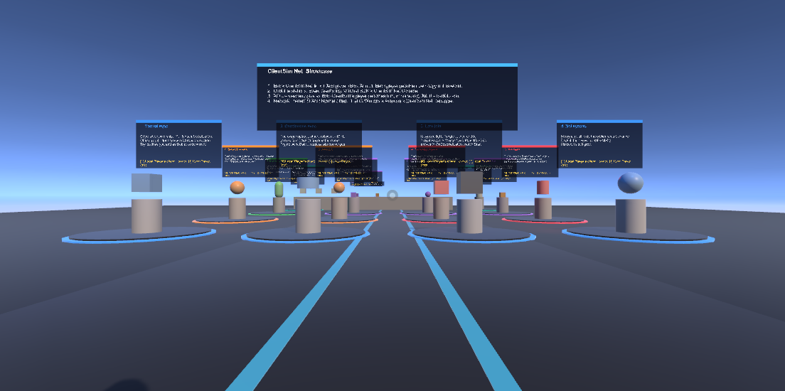
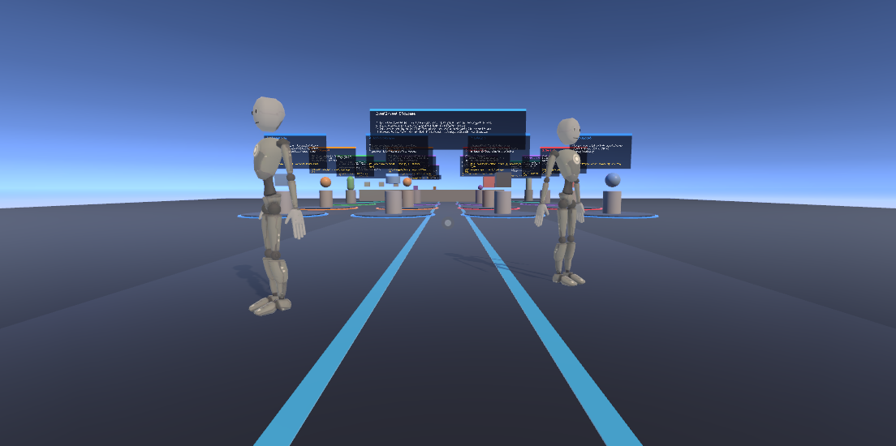
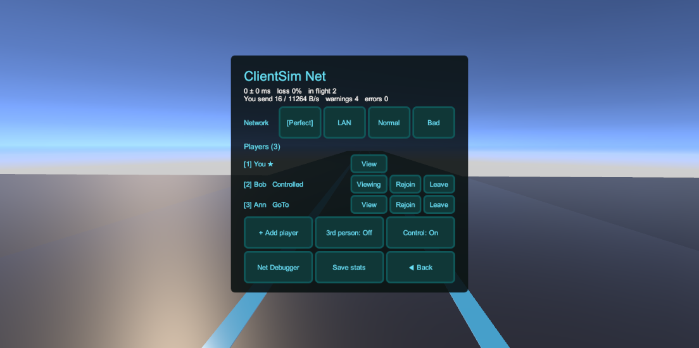

# ClientSim Net

> เวอร์ชันเอกสาร: **0.1.2** · [บันทึกประจำรุ่น](https://github.com/LogicCuteGuy/ClientSimNet/releases/tag/0.1.2)

**ClientSim Net** (`com.logiccuteguy.clientnetsim`) คือตัวจำลอง network แบบหลายผู้เล่นสำหรับ ClientSim ของ VRChat ClientSim เดิมไม่มี latency ไม่มี `OnDeserialization` และรัน event แบบ `Owner`/`Others` บนเครื่องตัวเอง บั๊ก networking ส่วนใหญ่จึงซ่อนอยู่จนกว่าจะ upload ClientSim Net เพิ่มผู้เล่น remote แบบหุ่น (puppet) เข้ามาใน Unity editor ตัวเดียว ให้ทดสอบใน Play mode ได้

[](/img/clientsimnet/showcase.png)

## สิ่งใหม่ใน 0.1.2

ตอนนี้ world ของผู้เล่น remote แต่ละคนมี PlayerObject ของผู้เล่นทุกคนเป็นสำเนาของตัวเอง state ที่ sync, network event, interact และ `Networking.FindComponentInPlayerObjects` ทำงานบน client ของผู้เล่นคนนั้นเอง จึงทดสอบ flow แบบ "คุณ → Bob" ได้โดยไม่ต้องต่อสายอะไรใหม่ (คลิกการ์ดของ Bob จะส่ง event แบบ `Owner` ไปหา Bob แล้ว Bob ตรวจสอบและเขียนค่า) object ที่มี network ซึ่งอยู่ที่ root ของ scene เช่น template ของ PlayerObject ระดับ root ก็ถูกคัดลอกเข้าทุก world ด้วย

0.1.1: world ของผู้เล่นทุกคนแสดงผู้เล่นคนอื่น (รวมคุณ) เป็น capsule ติดชื่อ ณ ตำแหน่งบน client ของคนนั้น ตอนดูมุมมองของ puppet จึงเห็นว่าใครอยู่ตรงไหน capsule เป็นแค่ภาพ ไม่มี collider และไม่มี latency

## ความสามารถ

- **ผู้เล่น remote แบบ puppet:** แต่ละคนมีสำเนา world ของตัวเอง ซึ่ง Udon ของคนนั้นทำงานอยู่ (`Networking.LocalPlayer`, `IsOwner`, `IsMaster` ตอบตามมุมมองของคนนั้น)
- **เส้นทาง network จริง:** ตัวแปร sync ผ่าน `RequestSerialization` และ `OnDeserialization` พร้อม latency, jitter และ packet loss มี preset: Perfect, LAN, Normal, Bad
- **ข้อจำกัดของ VRChat:** ขีดจำกัดขนาดของ manual sync (280,496 B) และ continuous sync (~200 B, 10 Hz), rate limit ของ `[NetworkCallable]` (5/s) และคำเตือน bandwidth ที่ ~11 KB/s
- **Ownership และ event:** target แบบ `All`/`Others`/`Owner`/`Self`, `OnOwnershipRequest` ทั้งสองฝั่ง, การแย่ง ownership, master และผู้เล่นออก, late join
- **Pickup และ PlayerObject:** pickup ทั้งแบบมีและไม่มี `VRCObjectSync` และสำเนา `VRCPlayerObject` ของแต่ละผู้เล่น
- **เครื่องมือ:** หน้าเมนูในเกม, หน้าต่าง timeline **Net Debugger**, console แยกตามผู้เล่น, สถิติที่บันทึกได้ และ scripting API (`NetSimApi`) พร้อม unity-mcp tool ชื่อ `clientsim_net`
- **World ตัวอย่าง:** ลานที่จัดแสงแล้ว มีสถานีพร้อมป้าย 14 จุด หนึ่งจุดต่อหนึ่งกรณีใช้งาน networking

[](/img/clientsimnet/puppets.png)

## ข้อกำหนด

- **Unity** 2022.3
- **VRChat Worlds SDK** 3.10.0 ขึ้นไป (`com.vrchat.worlds`)

## License

MIT

## การติดตั้ง

### VCC / ALCOM

1. [เพิ่ม repository VPM ของ LogicCuteGuy](https://vpm.logiccuteguy.com/) เข้า VCC/ALCOM หรือเพิ่ม `https://vpm.logiccuteguy.com/index.json` เอง ถ้าเพิ่มไว้แล้วให้ refresh รายการ
2. เปิด **Manage Project** ของโปรเจกต์ Unity
3. หา **ClientSim Net** (`com.logiccuteguy.clientnetsim`) แล้วเพิ่ม **0.1.2**
4. เปิดโปรเจกต์ใน Unity และรอให้ import แพ็กเกจ

### Unity Package Manager / ติดตั้งเอง

ใน **Window > Package Manager > + > Add package from git URL** ให้ใส่:

```text
https://github.com/LogicCuteGuy/ClientSimNet.git#0.1.2
```

เลือก**วิธีติดตั้งเพียงวิธีเดียวต่อโปรเจกต์** เพื่อไม่ให้มีสำเนาซ้ำ ห้ามใช้ **Source code (zip)** อัตโนมัติของ GitHub ให้ใช้ไฟล์ `com.logiccuteguy.clientnetsim-0.1.2.zip` จาก release

## เริ่มต้นใช้งาน

1. ใน **Package Manager > ClientSim Net > Samples** ให้ import **Test World** แล้วเปิด `NetSimShowcase.unity` (ทัวร์แนะนำ) หรือ `NetSimTest.unity` (ฉากทดสอบเปล่า ๆ)
2. กด **Play** ClientSim Net จะเริ่มพร้อม ClientSim
3. เปิด **VRChat SDK > ClientSim Net** เลือก network preset (**Normal** เพื่อความสมจริง, **Perfect** สำหรับการตรวจที่ได้ผลเหมือนกันทุกครั้ง) แล้วกด **Add player**
4. คลิก object ในฐานะตัวเอง แล้วใช้ปุ่ม 👁 ของผู้เล่นแต่ละคน (หรือ Alt+1..9 และ Alt+0 สำหรับตัวคุณ) เพื่อดูสำเนา world ของคนนั้นว่าเห็นอะไร

[](/img/clientsimnet/menu.png)

ปุ่มลัด: Alt+[ / Alt+] สลับผู้เล่น, Alt+T เปิดปิดมุมมองบุคคลที่สาม, Alt+C เปิดปิด **Control** (ผู้เล่นของ ClientSim ทำหน้าที่เป็น puppet ที่กำลังดู)

## เมนู

| เมนู | สิ่งที่เปิด |
|---|---|
| **VRChat SDK > ClientSim Net** | หน้าต่างหลัก: ปุ่มเปิดใช้งาน, preset, ผู้เล่น |
| **Window > Analysis > ClientSim Net Debugger** (มีใต้ VRChat SDK ด้วย) | timeline 30 วินาทีแบบ profiler ของ byte ที่ส่งจริง มีแท็บ Messages / Players / Objects |
| **VRChat SDK > ClientSim Net Console** | console หนึ่งแท็บต่อผู้เล่นหนึ่งคน |
| **VRChat SDK > ClientSim Net - Build Test Scene / Build Showcase Scene** | สร้างฉากตัวอย่างใหม่ |

บรรทัดใน console ของแพ็กเกจขึ้นต้นด้วย `[ClientSimNet]` warning และ error ในนั้นคือบั๊ก networking จริงใน world ของคุณ หรือข้อจำกัดที่คุณชน

## ต่างจาก VRChat อย่างไร

world ของ remote คำนวณฟิสิกส์ของตัวเอง แต่ raycast จาก Udon ในนั้นจะ query ฉากของคุณ puppet ไม่ชนกำแพง และไม่ได้จำลองเสียงกับอวาตาร์ ขนาด sync เป็นค่าประมาณตามชนิดข้อมูล ไม่ใช่ byte จริงบนสาย และ world ของผู้เล่นแต่ละคนใช้ทรัพยากรเท่าสำเนาฉากเต็มหนึ่งชุด ดูรายการทั้งหมดที่ [การใช้งาน ClientSim Net](./usage.md)

ถ้าต้องการปิดตัวจำลอง ให้ยกเลิกเครื่องหมาย **Enable** ในหน้าต่าง (มีผลตอน Play ครั้งถัดไป)

ถัดไป: [การใช้งาน ClientSim Net](./usage.md)
