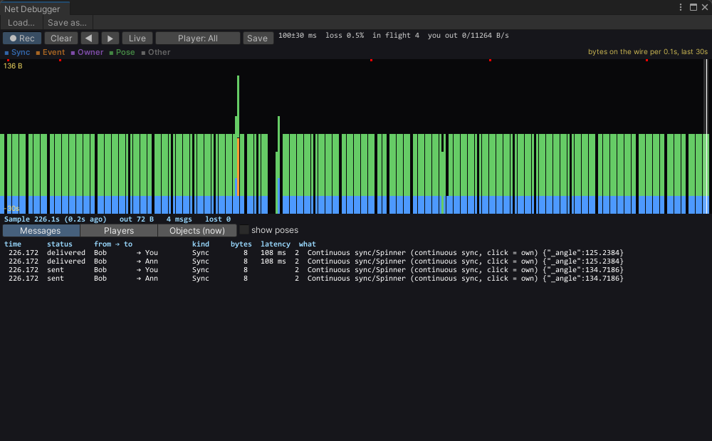

# การใช้งาน ClientSim Net

โค้ด networking ยังไม่ถือว่าเสร็จจนกว่าจะผ่าน[สถานการณ์ทดสอบ](./scenarios.md) ใน Play mode โดยมี**ผู้เล่น remote อย่างน้อยสองคน**

## แนวคิดการทำงาน

- Unity editor หนึ่งตัว มี **world หนึ่งสำเนาต่อผู้เล่นหนึ่งคน** puppet remote แต่ละตัวได้ฉากซ่อน `NetSim World <name> [id]` ซึ่งโหลดตอนเข้าร่วม สำเนาของคนนั้นเปลี่ยน**ผ่าน network เท่านั้น** (ตัวแปร sync, network event, ObjectSync, ownership) สิ่งที่ไม่ได้ sync จะต่างกันต่อไปเหมือนใน VRChat
- ทุกอย่างที่ข้าม network ผ่านการ encode เป็น byte, เข้าคิวหน่วงเวลา แล้ว decode
- `RequestSerialization` จากคนที่ไม่ใช่ owner จะถูกทิ้งพร้อมคำเตือน
- Event: `All` รันบนเครื่องตัวเองและส่งออก, `Others` ไม่รันบนเครื่องตัวเอง, `Owner` รันบนเครื่องตัวเองเมื่อคุณเป็น owner ของ object เท่านั้น, `Self` ทำงานเฉพาะเครื่องตัวเอง
- Late join: ยกเลิกเครื่องหมาย **Local Player Is Master** ของ ClientSim ก่อนกด Play จากนั้น master ฝั่ง remote จะส่ง state ของ behaviour ที่ sync ทุกตัวหลัง network นิ่งได้ไม่นาน

## Scripting

ควบคุมตัวจำลองจากโค้ดด้วย `NetSimApi` หรือ unity-mcp tool ชื่อ `clientsim_net` ดู [Scripting และ unity-mcp](./scripting-api.md)

## Net Debugger

**Net Debugger** แสดง timeline 30 วินาทีของ byte ที่ส่ง แบ่งช่วงละ 0.1 วินาที และซ้อนตามประเภท (Sync, Event, Owner, Pose) คลิกหรือลากเพื่อเลือก sample แท็บด้านล่างจะแสดง message ในช่วงนั้น (ผู้ส่ง, ผู้รับ, ขนาด, latency, payload), ยอดรวมแยกตามผู้เล่น และ state ของแต่ละ object สีแดงหมายถึงชนขีดจำกัด, message หาย หรือ object ไม่ตรงกัน ส่วน **CLOGGED** หมายถึง traffic ขาออกของคุณเกิน ~11 KB/s ปุ่ม **Save** เขียนไฟล์ `Library/ClientSimNet/netstats-<time>.json` และ **Load…** เปิดกลับมาดูภายหลังได้ แม้ไม่ได้อยู่ใน Play mode

## สถานการณ์ทดสอบ

รัน[สถานการณ์ทดสอบ](./scenarios.md)ข้อที่เกี่ยวกับฟีเจอร์ของคุณ

## ข้อจำกัดที่ทราบ {/* #known-limits */}

- ขนาด sync เป็นค่าประมาณตามชนิดข้อมูล ไม่ใช่ byte จริงบนสาย
- Player API อื่นนอกจาก `TeleportTo` (Immobilize, SetWalkSpeed, …) ไม่มีผลกับ puppet
- `Physics.Raycast` จาก Udon ฝั่ง remote จะ query ฉากของคุณ และร่างของ puppet ไม่ได้อยู่ใน world ของตัวเอง
- object ที่ spawn ด้วย `VRCInstantiate` จะไปอยู่ในฉากของคุณ (ตั้งแต่ 0.1.2 PlayerObject มีสำเนาของตัวเองในทุก world)
- puppet spawn จาก `VRCObjectPool` ไม่ได้ ให้ใช้การ take ownership ของ object ใน pool แทน
- ระบบเข้าถึงส่วนภายในของ SDK ผ่าน reflection หลังอัปเดต SDK ให้รัน **Test Runner > EditMode > ClientSimNet.Tests** ก่อน
