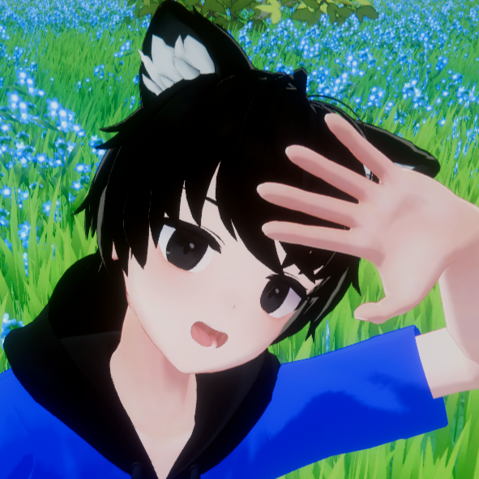

# LogicCuteGuy VRC/Unity

  

ยินดีต้อนรับสู่คลังเครื่องมือพัฒนา Unity และ VRChat ของ **LogicCuteGuy** เรานำเสนอชุดเครื่องมือที่ออกแบบมาเพื่อเพิ่มประสิทธิภาพเวิร์กโฟลว์ ปรับปรุงประสิทธิภาพ และทำให้การสร้างโลกเป็นเรื่องง่าย

  <h2 style={{margin: 0, fontSize: '1.8rem', fontWeight: 800}}>การติดตั้งอย่างรวดเร็ว</h2>
  
เพิ่มคลังเครื่องมือของเราลงใน VRChat Creator Companion (VCC) เพื่อเข้าถึงและอัปเดตเครื่องมือทั้งหมดด้วยการคลิกเพียงครั้งเดียว

  
  <a href="vcc://vpm/addRepo?url=https://vpm.logiccuteguy.com/index.json" className="button--vcc" style={{fontSize: '1.2rem', padding: '16px 36px'}}>
    ติดตั้งผ่าน VCC
    <svg width="24" height="24" viewBox="0 0 24 24" fill="none" stroke="currentColor" strokeWidth="3" strokeLinecap="round" strokeLinejoin="round"><path d="M5 12h14"></path><path d="M12 5l7 7-7 7"></path></svg>
  </a>
  
  รองรับ Unity 2022.3.x และ VCC

[รับโค้ด VCC embed แบบสี่เหลี่ยมจัตุรัสสำหรับ BOOTH](/th/booth-embed)

## โปรเจกต์ที่พร้อมใช้งาน

แพ็กเกจทั้งหมดมีใน [รายการ VPM ของ LogicCuteGuy](./packages.md) (`https://vpm.logiccuteguy.com/index.json`) และ DigHoleIt ยังมี Git tag กับแพ็กเกจ GitHub Release แบบมีชื่อ

### [Help Tools (เครื่องมือช่วยเหลือ)](./helptools/intro.md) — `com.logiccuteguy.helptools` v1.0.1
ชุดเครื่องมือ Editor ระดับมืออาชีพกว่า 15 รายการ สำหรับการปรับขนาด Lightmap, การวิเคราะห์การใช้งาน Asset, การจัดการ Shader และการจัดระเบียบ Hierarchy

### [LCGUdonSharp](./lcgudonsharp/intro.md) — `com.logiccuteguy.lcgudonsharp` v0.5.0

LCGUdonSharp **0.5.0** hook เข้ากับ UdonSharp ของ VRChat SDK แทนการแทนที่ ไม่มี installer และไม่แก้ไฟล์ของ SDK ต้องใช้ Worlds SDK `>=3.10.6 <3.11.0` ระบบ network ฝั่งคอมไพเลอร์ถูกนำออก (ดู [LCG Network System](./unity-vrc/lcgnetwork/intro)) ไม่ต้องใช้แพ็กเกจ SBP compatibility แล้ว และ release ไม่มีตัวอย่าง การอัปเกรดจาก 0.4.x หรือเก่ากว่าต้องทำขั้นตอนเพิ่ม ดู[การติดตั้ง](./lcgudonsharp/install.md) บันทึกของรุ่นก่อนหน้าด้านล่างเป็นประวัติ

LCGUdonSharp 0.3.12 เตือนแทนการบล็อกเมื่อ VRChat Worlds SDK ที่ติดตั้งอยู่ไม่ตรงกับเวอร์ชันที่รองรับ `3.10.5`: payload (build จาก SDK 3.10.5) ยังติดตั้งตามเดิม พร้อมแจ้งว่า **Tools > LCGUdonSharp > Restore** ย้อนกลับไปยัง UdonSharp ต้นฉบับที่สำรองไว้ นอกจากนี้ยังประกาศตัวอย่าง **LCGUdonSharp Examples** ใน `package.json` ทำให้ Package Manager แสดงรายการ ให้นำเข้าหลังติดตั้งคอมไพเลอร์อัตโนมัติเสร็จ

LCGUdonSharp 0.3.10 ติดตั้ง dependency แบบ embedded **SBP compatibility 1.21.26** ผ่าน VPM ก่อน Unity compile เพื่อกัน VRChat SDK `ExtensionMethods` ชนทั้งตอนติดตั้งใหม่และอัปเกรด ใช้ฐาน Unity SBP 1.21.25 โดยรักษา source/GUID และ Unity Companion License และยังอยู่หลังสร้าง `Library` ใหม่ Unity Localization 1.4.5 ยังรองรับ ดู[การติดตั้ง](./lcgudonsharp/install.md) การติดตั้งเองต้องใช้ release ZIP **ทั้งสองไฟล์**

LCGUdonSharp 0.3.9 เพิ่ม [Localization ของข้อความและ asset](./lcgudonsharp/localization.md): bake Unity String/Asset Tables เป็น Udon, เลือกภาษาแบบ local พร้อม fallback, dropdown/callback, Smart Strings ที่ตรวจ syntax และสลับ sprite/texture/เสียง/prefab เพิ่มตัวอย่าง EN/TH/JA, เครื่องมือ JSON เดิม, dependency Unity Localization 1.4.5 และ Scriptable Build Pipeline 1.21.25 พร้อมแก้ compatibility ตอน build และ compiler worker thread ต้อง build world ใหม่หลังแก้ table หรืออัปเดต

LCGUdonSharp 0.3.8 เพิ่ม [snapshot ข้อมูล ScriptableObject](./lcgudonsharp/scriptableobjects.md) แบบซ้อนและ polymorphic พร้อม type test และ checked cast, ตรวจ cycle/ความลึก และตัวอย่างอุปกรณ์แบบ local ต้อง build Udon program ทั้งหมดและ bake ข้อมูล scene/prefab ใหม่หลังอัปเดต เพราะ snapshot ใช้ layout ใหม่ที่มี runtime type tag

ส่วนเสริมคอมไพเลอร์ UdonSharp สำหรับ VRChat: C# interface, async/await ตอน build, try/catch/finally แบบ synchronous, collection/JSON และความสามารถภาษาเพิ่มเติม

### [DigHoleIt](./digholeit/intro.md) — `com.logiccuteguy.digholeit` v0.7.2

DigHoleIt 0.7.0 เพิ่ม prefab Dig Pen, ปลูก/ลบ tree และ detail ตอน runtime (รวม foliage ที่ bake ไว้), smoothing แบบ sync, VRChat showcase และ Refresh Holes / Refresh Zones การตั้งค่าเป็น local แต่ edit ใน VRChat sync และ replay ให้ late joiner

0.7.2 มีทั้งใน VPM และ GitHub ดู[วิธีติดตั้ง](./digholeit/getting-started.md)
ระบบ voxel terrain ที่ขุดได้สำหรับ Unity รองรับหลุม อุโมงค์ ถ้ำ การเติมดิน และระบาย terrain layer ตอน runtime พร้อมการ sync ใน VRChat และ runtime C# สำหรับเกม standalone

### [BlendProperty](./blendproperty/intro.md) — `com.logiccuteguy.blendproperty` v0.2.2

0.2.1 เป็นรุ่นอัปเดตเอกสาร เพิ่มขั้นตอนติดตั้งผ่าน VCC/ALCOM และอธิบายทางเลือก Git/ZIP ให้ชัดเจนขึ้น Runtime code และ example asset ไม่เปลี่ยนจาก 0.2.0

0.2.0 แก้ความเข้ากันได้ของ VRChat panel โดย Control Panel และ Cloth Panel ใช้ `NoVariableSync` จึงอยู่ GameObject เดียวกับ Synced Control Panel ที่เป็น `Manual` ได้ พร้อมแก้ shader reference ใน baked GPU deform texture ของ example และอัปเดต VRChat scene ฟีเจอร์ GPU/native physics เดิมยังใช้ได้

Mesh modifier stack และ GPU physics สำหรับ Unity พร้อม component ร่วม VRChat/native standalone. [การตั้งค่า](./blendproperty/intro.md) · [Runtime](./blendproperty/runtime.md) · [Physics](./blendproperty/physics.md)

### [WASM2HLSL](./wasm2hlsl/intro.md) — `com.logiccuteguy.wasm2hlsl` v0.2.2

WASM2HLSL 0.2.0 อ่านตารางค่าคงที่ขนาดใหญ่จากเท็กซ์เจอร์: `.rodata` ที่ 1 KB ขึ้นไปไม่นับรวมในขีดจำกัดหน่วยความจำ 64000 byte จึงลดขีดจำกัดขนาดสำหรับโมดูลที่ใหญ่ขึ้น โมดูล `.wasm` ถูกแปลงเป็น HLSL ใน editor แล้วเรียกจาก UdonSharp ทีละพิกเซลผ่าน Blit + async GPU readback

รัน WebAssembly บน GPU ใน VRChat world เขียน kernel เป็น Rust/C/Zig แทน HLSL ด้วยมือ [ภาพรวม](./wasm2hlsl/intro.md) · [เริ่มต้นใช้งาน](./wasm2hlsl/getting-started.md)

### [UIHUD](./uihud/intro.md) — `com.logiccuteguy.uihud` v0.2.0

HUD, เมนูแบบเลื่อนเข้า และ UI widget สำหรับ world ของ VRChat และเกม Unity แบบ standalone ตั้งค่าครั้งเดียวใช้ได้ทั้ง VR, desktop และมือถือ ได้แก่ HUD ของผู้เล่น, เมนูแบบเลื่อนเข้า, panel ใน world, hotbar, style preset และ widget ตอน runtime จาก Udon

UIHUD **0.2.0** แก้พฤติกรรมของเมนูและ HUD (การพิมพ์ไม่ไปกดปุ่มเมนูแล้ว และเมนูใน VR เปิดในแนวระดับ) เพิ่มการทำให้ toggle Show HUD ตรงกับสถานะ และเพิ่มตัวอย่าง 0.1.2 ผ่อน dependency ของ Worlds SDK เป็น `3.x.x` (`>=3.10.5`) ส่วน 0.1.1 ทำให้เครื่องหมายถูกของ toggle ยืดเต็มช่อง checkbox และเพิ่มภาพหน้าจอตัวอย่างใน README

[ภาพรวม](./uihud/intro.md) · [เริ่มต้นใช้งาน](./uihud/getting-started.md)

### [LCG Localization](./lcglocalization/intro.md) — `com.logiccuteguy.lcglocalization` v0.1.0

แปลข้อความและ asset สำหรับ UdonSharp: bake Unity String Table และ Asset Table เป็น Udon พร้อม dropdown, callback, ตัวแปร Smart และ fallback ใช้ได้กับ UdonSharp ของ VRChat SDK และ LCGUdonSharp

[ภาพรวม](./lcglocalization/intro.md)

### [ClientSim Net](./clientsimnet/intro.md) — `com.logiccuteguy.clientnetsim` v0.1.2

ตัวจำลอง network แบบหลายผู้เล่นสำหรับ ClientSim ของ VRChat: ผู้เล่น remote แบบ puppet ที่มีสำเนา world ของตัวเอง, latency/jitter/loss, การส่งตัวแปร sync และ event จริง, ownership, late join, pickup และ network debugger ช่วยจับบั๊ก networking ใน editor ตัวเดียวก่อน upload

[ภาพรวม](./clientsimnet/intro.md) · [การใช้งาน ClientSim Net](./clientsimnet/usage.md)

### [LCG Network System](./lcgnetwork/intro.md) — `com.logiccuteguy.lcgnetwork` v0.1.0

networking แบบจำกัดตามโซนสำหรับ world ของ VRChat โดยจัดเส้นทาง networking ปกติของ UdonSharp, Udon Graph และ Udon Assembly ผ่านโซนตอน build ตัวแปร sync และ event จึงไปถึงเฉพาะผู้เล่นข้างใน เป็นรุ่น preview

[ภาพรวม](./lcgnetwork/intro.md) · [การใช้งาน LCG Network](./lcgnetwork/usage.md)

### [OpenWorld](./openworld/intro.md) — `com.logiccuteguy.openworld` v0.0.1

เอนจินโลกแบบแบ่งกริดเป็น chunk สำหรับ VRChat: สตรีม chunk, impostor, Block แบบ GPU instancing และแก้ไขขณะเล่น

[ภาพรวม](./openworld/intro.md) · [เริ่มต้นใช้งาน](./openworld/getting-started.md)

### [StreamData](./streamdata/intro.md) — `com.logiccuteguy.streamdata` v0.0.1

สตรีม texture และ lightmap ของโลก VRChat จากเว็บหลังโลกโหลดเสร็จ พร้อมเผยแพร่ขึ้น GitHub Pages หรือโฮสต์ของคุณเอง

[ภาพรวม](./streamdata/intro.md) · [เริ่มต้นใช้งาน](./streamdata/getting-started.md)

### [ZoneDraw](./zonedraw/intro.md) — `com.logiccuteguy.zonedraw` v0.1.0

คลิกเพื่อวาดกำแพงล่องหนและพื้นที่ trigger แล้ว bake เป็น collider ปกติ พร้อม API สำหรับ UdonSharp

[ภาพรวม](./zonedraw/intro.md) · [เริ่มต้นใช้งาน](./zonedraw/getting-started.md)

ดูเวอร์ชัน การพึ่งพา และ repository ได้ที่[รายการแพ็กเกจ](./packages.md)

---

## การสนับสนุนและชุมชน
- **GitHub**: [LogicCuteGuy Repository](https://github.com/LogicCuteGuy)
- **อัปเดต**: ติดตามเราเพื่อรับข่าวสารเครื่องมือล่าสุดและการเพิ่มประสิทธิภาพ
